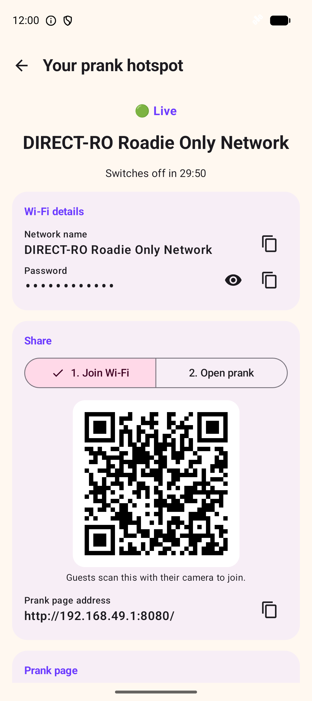
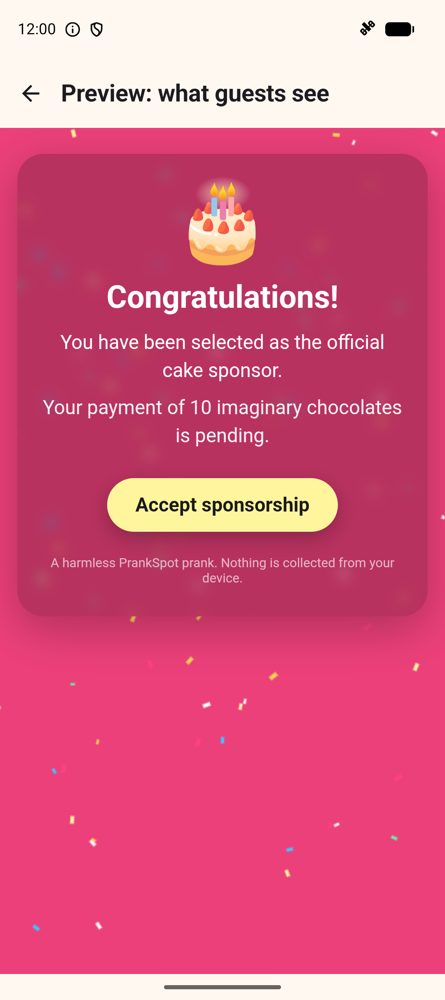
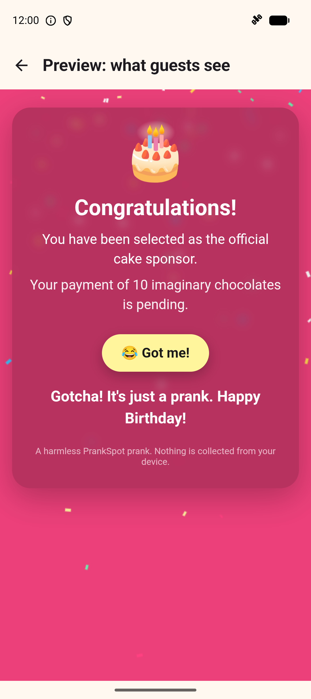
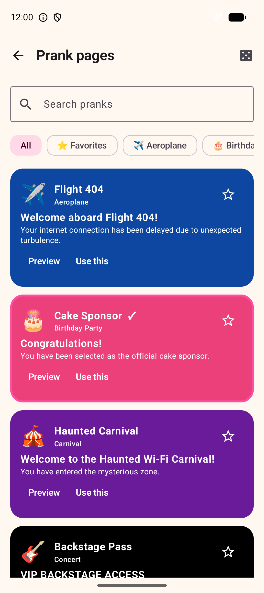

# PrankSpot

An offline Android app for creating funny Wi-Fi hotspots and serving a harmless prank page to whoever connects.

**Create a funny network. Let someone connect. Surprise them with a hilarious page.**

**[Download PrankSpot 0.1.0 (APK)](https://github.com/er-shrey/prankspot/releases/download/v0.1.0/PrankSpot-0.1.0.apk)** · Android 8.0+

| Home | Pick a theme | Set up | Live |
|---|---|---|---|
|  |  |  |  |

| Prank page | The reveal | Hacker prank | Prank library |
|---|---|---|---|
|  |  |  |  |

## What it does

- **17 themes** (Aeroplane, Birthday, Carnival, Concert, Wedding, Gaming, Police / FBI, Hacker, School, Office, Hospital, Restaurant, Hotel, Christmas, Halloween, Alien Invasion, Custom), each with 20+ funny network names and its own prank page.
- **Name generator** that doesn't repeat itself, plus manual editing, favorites, and 32-byte / emoji checks.
- **Easy-to-say passwords** like `WobblyPickle47`.
- **Three hotspot modes**
  - 🎭 *Funny name* (default, Android 10+): a Wi-Fi Direct group with your name and password, no internet. Guests see e.g. `DIRECT-FS FBI Surveillance Van`; Android requires the `DIRECT-xy` prefix and a password for networks an app creates.
  - 🌐 *Share internet*: your phone's own hotspot. Android doesn't let apps switch it on or name it, so PrankSpot opens hotspot settings with the name and password ready to copy (or Security: None for an open network), waits until it sees the hotspot, then serves the prank page on it.
  - ⚡ *Quick*: a local-only hotspot in one tap; Android picks the name (`AndroidShare_1234`) and password.
- **Local prank page server** (embedded Ktor). It binds only to the hotspot's own address, answers GET only, and redirects captive-portal probes and every other path to the prank.
- **QR codes** for joining the Wi-Fi and for opening the prank page, with copy buttons.
- **Session timer** with auto shutdown, +15 min, a foreground notification with a Stop button, and a short history.
- **Guests list**: devices that opened the prank page, with fun nicknames. It's kept in memory only.
- Light/dark theme, and a settings screen for the defaults.

## Honest limits

- **Hotspot names:** apps can't name a regular hotspot. For `startLocalOnlyHotspotWithConfiguration`, only the channel setting is public API; the name and password setters are system-only, so Android replaces them with `AndroidShare_XXXX`. That's why the funny-name mode uses Wi-Fi Direct (name must start with `DIRECT-xy`, at most 22 bytes after it, password required).
- **Open networks** can only be made from your phone's hotspot settings (*Share internet* mode, Security: None).
- **Automatic captive-portal pop-ups** need control of DHCP and DNS, which normal apps don't have. Guests open the page by QR code or address. If a device happens to probe the server directly, the probe is redirected to the prank.
- **Who joined** isn't visible to apps, so the guest list counts devices that opened the page.
- **Maximum devices** and **blocking** need system-only APIs, so they aren't offered.
- **HTTPS is never touched.** There's no interception, no certificates, no forms, and nothing is collected.

## Privacy

No account, no cloud, no analytics. Session history (name, theme, time, guest count) stays on the phone and can be cleared. Passwords and guest addresses are never saved.

## Build

Kotlin, Jetpack Compose (Material 3), Room, DataStore, Ktor CIO server, ZXing. minSdk 26, compiled against `android-36.1`.

```bash
./gradlew testDebugUnitTest assembleDebug
```

The APK is written to `app/build/outputs/apk/debug/app-debug.apk`.
