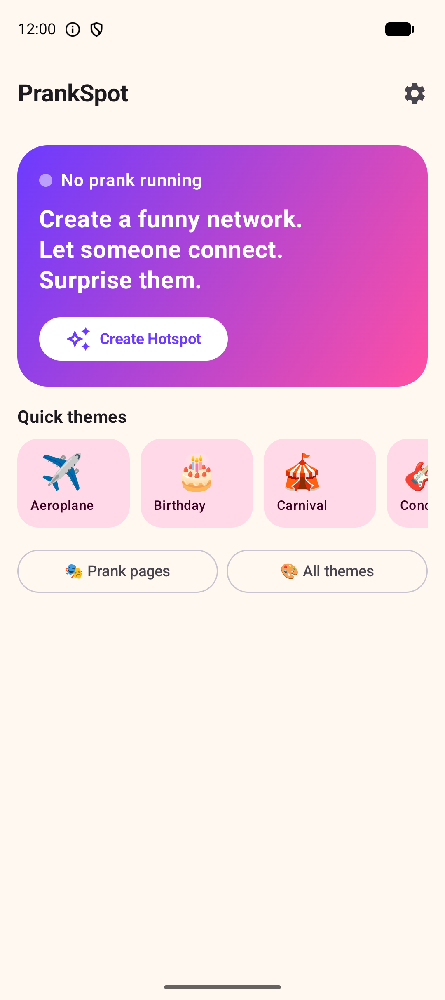
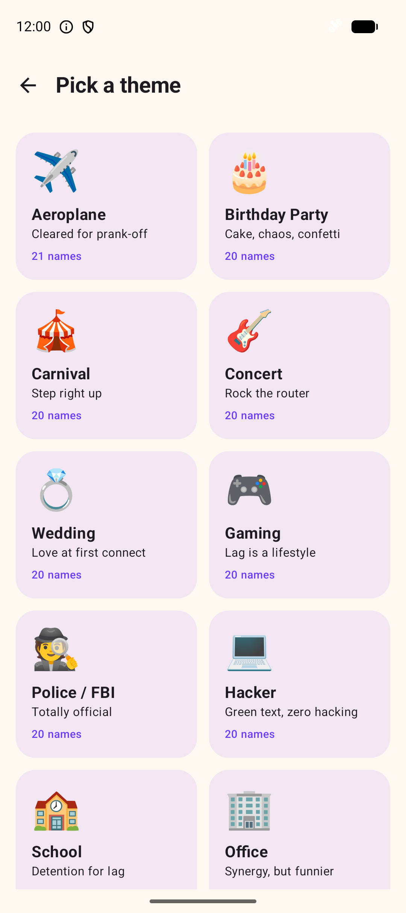
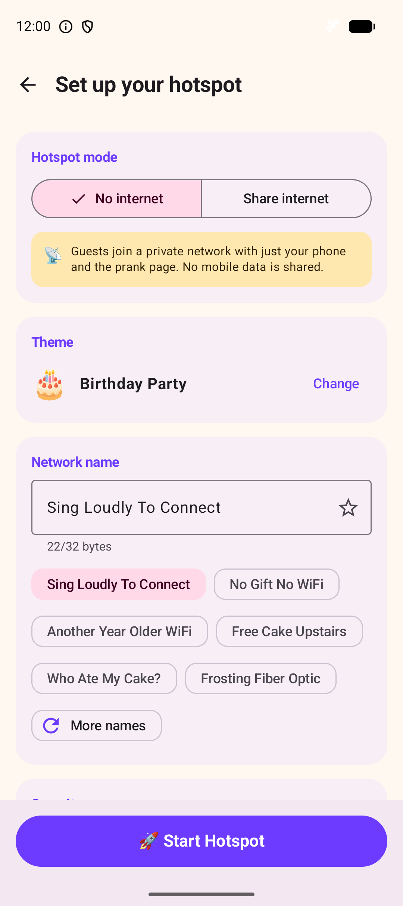
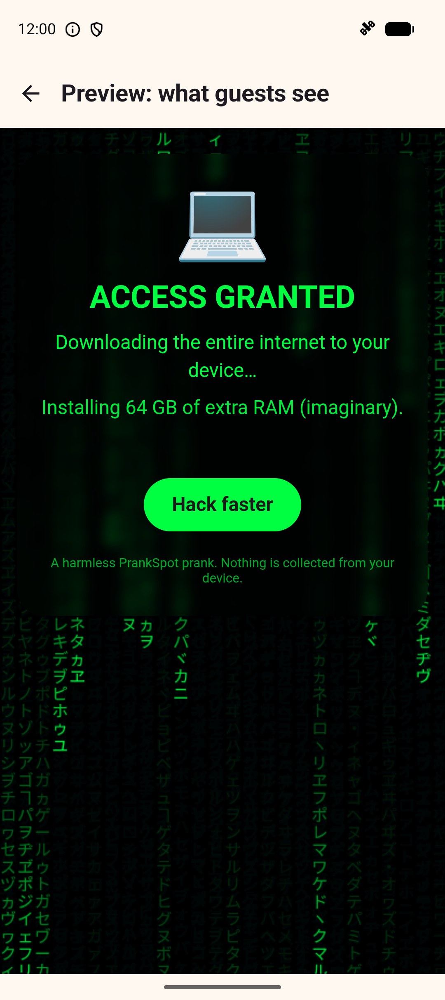

# PrankSpot

An offline Android app for creating funny Wi-Fi hotspots and serving a harmless prank page to whoever connects.

**Create a funny network. Let someone connect. Surprise them with a hilarious page.**

| Home | Pick a theme | Set up | Live |
|---|---|---|---|
|  |  |  |  |

| Prank page | The reveal | Hacker prank | Prank library |
|---|---|---|---|
|  |  |  |  |

## What it does

- **17 themes** (Aeroplane, Birthday, Carnival, Concert, Wedding, Gaming, Police / FBI, Hacker, School, Office, Hospital, Restaurant, Hotel, Christmas, Halloween, Alien Invasion, Custom), each with 20+ funny network names and its own prank page.
- **Name generator** that doesn't repeat itself, plus manual editing, favorites, and 32-byte / emoji checks.
- **Easy-to-say passwords** like `WobblyPickle47`, or an open network.
- **Two hotspot modes**
  - *No internet*: a local-only hotspot started by the app (`WifiManager.startLocalOnlyHotspot`).
  - *Share internet*: Android doesn't let apps switch on tethering, so PrankSpot opens hotspot settings, waits until it sees your hotspot, then serves the prank page on it.
- **Local prank page server** (embedded Ktor). It binds only to the hotspot's own address, answers GET only, and redirects captive-portal probes and every other path to the prank.
- **QR codes** for joining the Wi-Fi and for opening the prank page, with copy buttons.
- **Session timer** with auto shutdown, +15 min, a foreground notification with a Stop button, and a short history.
- **Guests list**: devices that opened the prank page, with fun nicknames. It's kept in memory only.
- Light/dark theme, and a settings screen for the defaults.

## Honest limits

- **Custom hotspot names:** Android lets apps name a local-only hotspot only from Android 16 QPR2 (API 36.1), through `startLocalOnlyHotspotWithConfiguration`. On the API 37 emulator the system still replaced the name with `AndroidShare_XXXX`. PrankSpot reads back the real name and password and shows those, with a note. On older phones, use *Share internet* mode and type the funny name into your hotspot settings.
- **Automatic captive-portal pop-ups** need control of DHCP and DNS, which normal apps don't have. Guests open the page by QR code or address. If a device happens to probe the server directly, the probe is redirected to the prank.
- **Who joined** isn't visible to apps, so the guest list counts devices that opened the page.
- **Maximum devices** and **blocking** need system-only APIs, so they aren't offered.
- **HTTPS is never touched.** There's no interception, no certificates, no forms, and nothing is collected.

## Privacy

No account, no cloud, no analytics. Session history (name, theme, time, guest count) stays on the phone and can be cleared. Passwords and guest addresses are never saved.

## Build

Kotlin, Jetpack Compose (Material 3), Room, DataStore, Ktor CIO server, ZXing. minSdk 26, compiled against `android-36.1`.

```bash
./gradlew testDebugUnitTest assembleDebug
```

The APK is written to `app/build/outputs/apk/debug/app-debug.apk`.
